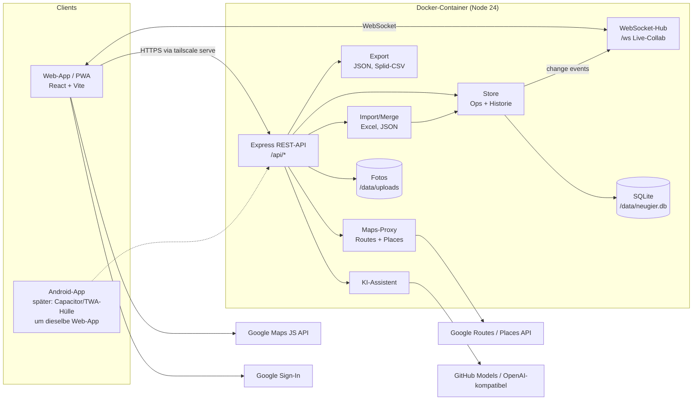
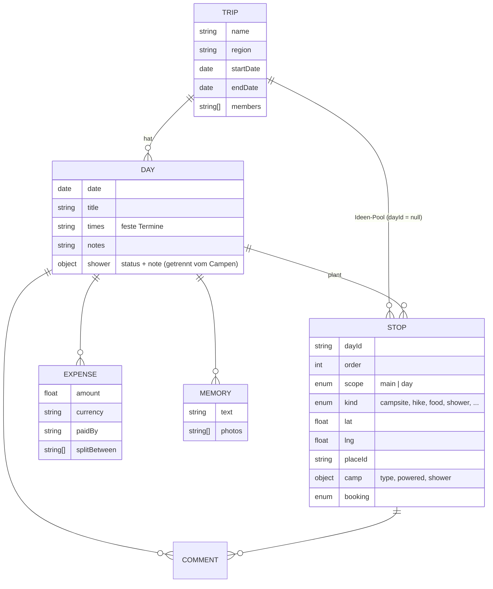
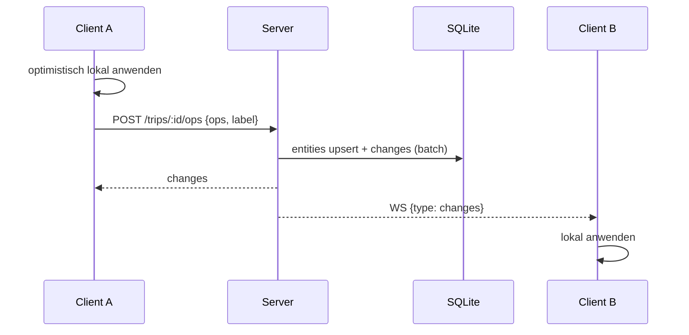
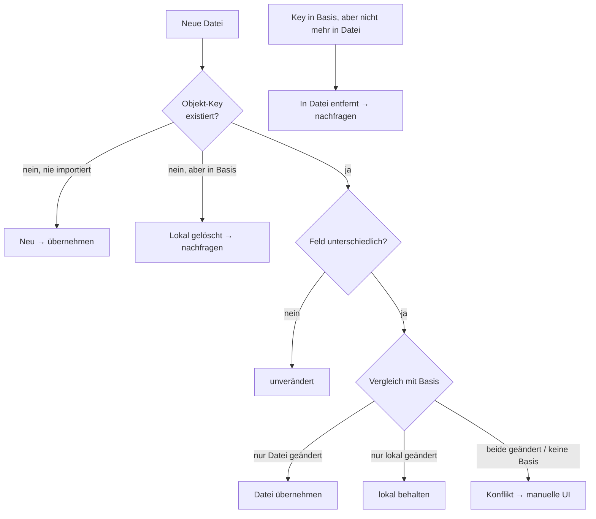
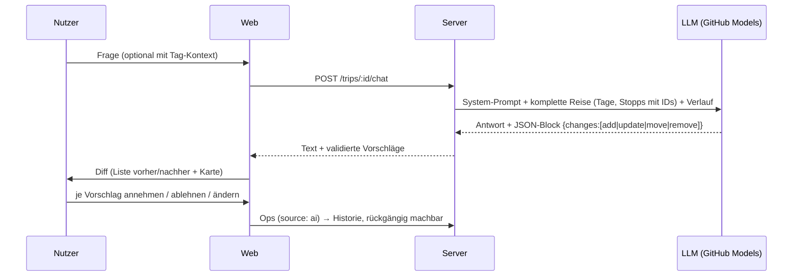

# Architektur

NEUGIER ist ein Reisehelfer für Routenplanung vor und während der Reise. Ziel: **einfach, selbst gehostet, modular**.

## Überblick

* **Ein Container**, ein Port (8080). Der Server liefert auch die gebaute Web-App aus.
* **SQLite** über das in Node 24 eingebaute `node:sqlite` – keine nativen Abhängigkeiten.
* TypeScript wird zur Laufzeit per `tsx` ausgeführt (kein separater Server-Build).
* Paket-Struktur (npm workspaces):

| Paket | Inhalt |
|---|---|
| `shared/` | Datentypen, Labels (deutsch), Google-Maps-Links, Routen-Logik, KI-Vorschlag → Ops |
| `server/` | API, Auth, Store/Historie, Realtime, Import/Merge, Export, Maps-Proxy, LLM, Seed |
| `web/` | React-SPA (mobil-first, Lightmode), PWA-Manifest |

## Datenmodell

Alle Reise-Objekte werden als JSON-Dokumente in einer Tabelle `entities` gespeichert (einfach erweiterbar ohne Migrationen).

### Hauptroute vs. Tagesroute

Jeder Stopp hat `scope`:

* `main` – Teil der **Hauptroute** (Übernachtung, Transfers). Erscheint auf der Gesamtreise-Karte.
* `day` – nur **Tagesroute** (Café, Wanderung, Dusche, Einkauf …). Erscheint nur in der Tagesansicht.

Die Gesamtreise-Karte zeigt pro Tag das **Übernachtungsziel** (letzter `main`-Stopp vom Typ Campingplatz/Unterkunft).
Die Tagesroute startet am Übernachtungsort des Vortags.

### Duschen ≠ Campen

Duschen sind pro Tag separat geplant (`day.shower` mit Status + Ort) und können zusätzlich als eigener Stopp (`kind: shower`) eingeplant werden – unabhängig davon, ob der Campingplatz Duschen hat (`stop.camp.shower`).

## Änderungen, Live-Collab & Versionshistorie

Jede Änderung ist eine Liste von **Operationen** (`create | update | put | delete`). Der Server wendet sie in einer Transaktion an,
schreibt für jedes Objekt Vorher/Nachher in die Tabelle `changes` und verteilt sie per WebSocket.

* **Batch** = eine Nutzeraktion (z. B. „KI-Vorschlag übernommen (3)“) → als Ganzes rückgängig machbar.
* **Einzel-Version** eines Stopps wiederherstellen (Historie am Stopp).
* Rollbacks sind selbst wieder Änderungen (nichts geht verloren).
* Präsenz: Wer ist online, wer schaut welchen Tag an.
* Konfliktstrategie live: *last write wins* pro Feld-Patch (für 2–5 Mitreisende ausreichend).

## Rollen

| Rolle | Rechte |
|---|---|
| Wartet auf Freigabe | nichts (nach erstem Google-Login) |
| Zuschauer | Reiseübersicht und Erinnerungen lesen, geteilten Standort sehen |
| Mitarbeiter | planen, kommentieren, importieren, Ausgaben und Erinnerungen bearbeiten, Standort teilen |
| Admin | zusätzlich Nutzerverwaltung + KI-Einstellungen |

Der erste Nutzer und alle E-Mails aus `ADMIN_EMAILS` werden automatisch Admin.
Login über **Google Sign-In** (ID-Token wird serverseitig geprüft) → Session-Cookie. Ohne `GOOGLE_CLIENT_ID` gibt es einen Dev-Login.

## Import / Export

### Formate

| Format | Richtung | Zweck |
|---|---|---|
| `*.neugier.json` (`format: neugier-trip, version: 1`) | Export + Import | Vollständiges Backup / Austausch |
| Excel nach Template `Routenplanung.xlsx` | Import (+ Re-Import) | Planung in Excel weiterführen |
| Splid-CSV (`;`-getrennt) | Export | Ausgaben nach Splid übertragen |

**Excel-Template** (Blatt `Reiseverlauf`, ab Zeile 4):

| A | B | C | D | E | F | G | H | I |
|---|---|---|---|---|---|---|---|---|
| Tag-Nr | Route/Titel | Datum | Uhrzeit | Aktivitäten | Campsite | Duschen? | Details | Preise |

Optional `Tabelle1` mit Abschnitten „Nordinsel“, „Südinsel“, „Wanderungen“ → Ideen-Pool.

### Merge beim (Re-)Import

Jedes importierte Objekt erhält einen stabilen `key` (z. B. `xl:camp:2026-12-20`). Pro Quelle wird der zuletzt importierte Stand als **Basis** gespeichert → echter 3-Wege-Merge:

Die Konflikt-UI zeigt pro Feld „Aktuell“ vs. „Aus Datei“ zum Anklicken. Der gesamte Import ist ein Batch und damit per Historie rückgängig machbar.

## Karten & Routen (Google)

* **Maps JavaScript API** (Browser-Key) mit Advanced Markers – eigene Pins pro Tag/Stopp (Stil wie Rankers).
* **Routes API** (Server-Key) berechnet die Fahrroute als Polyline, Distanz und Dauer pro Etappe. Ergebnisse werden in SQLite gecached.
* **Places API (New)** für die Ortssuche beim Anlegen von Stopps.
* **Quicklinks**: Jeder Stopp, jede Tagesroute und die Gesamtroute öffnen per Google-Maps-URL (`/maps/dir/?api=1…`) direkt die Navigation (auf Android in der Google-Maps-App).
* Ohne API-Key: vereinfachte Vorschau (Punkte + Luftlinien), alle Quicklinks funktionieren trotzdem.
* Mitarbeiter können auf der Reiseübersicht ihren GPS-Standort freigeben. Solange die App geöffnet und die Freigabe aktiv ist, speichert der Server die letzte aktuelle Messung pro Reise in SQLite und verteilt sie per WebSocket an alle Rollen. Die Freigabe läuft beim Seitenwechsel weiter und endet beim Deaktivieren oder Schließen der App. Browser benötigen dafür Standortfreigabe und HTTPS (lokal genügt localhost).
* Stammt die letzte Messung nicht vom aktuellen Reisetag, zeigt die Übersicht das geplante Übernachtungsziel dieses Tages. Fehlen Koordinaten, wird es bei verfügbarer Places API anhand des Namens gesucht; ohne Treffer oder geplantes Ziel gibt es keinen Standortmarker. Für Neuseeland gilt `Pacific/Auckland`, ansonsten UTC; eine Reise kann eine IANA-Zeitzone über `timeZone` festlegen. Der gespeicherte Standort ist Teil des Datenbank-Backups und bleibt nach Deaktivieren bis zu einer neuen Messung erhalten.

## KI-Assistent

OpenAI-kompatible Chat-Completions-API; Standard ist GitHub Models (`https://models.github.ai/inference`, Key = GitHub PAT mit `models:read`).
Basis-URL, Modell und Key sind im Admin-Dashboard änderbar.

## Android

Die Web-App ist mobil-first und als PWA installierbar („Zum Startbildschirm hinzufügen“). Für eine echte Android-App ohne eigenes Framework:

* **Trusted Web Activity** (z. B. mit Bubblewrap) – reine Hülle um die PWA, oder
* **Capacitor** – gleiche React-App, zusätzlich Zugriff auf native APIs (Kamera, Standort).

In beiden Fällen bleibt der Code in `web/` die einzige UI-Codebasis.

## Erweiterungsideen

* Offline-Cache (Service Worker) für Gegenden ohne Netz (z. B. Milford Sound)
* Drag & Drop für Stopps, Tag einfügen/verschieben
* Mehrere Reisen in der UI anlegen (API existiert bereits)
* Splid-Import der Salden zurück
